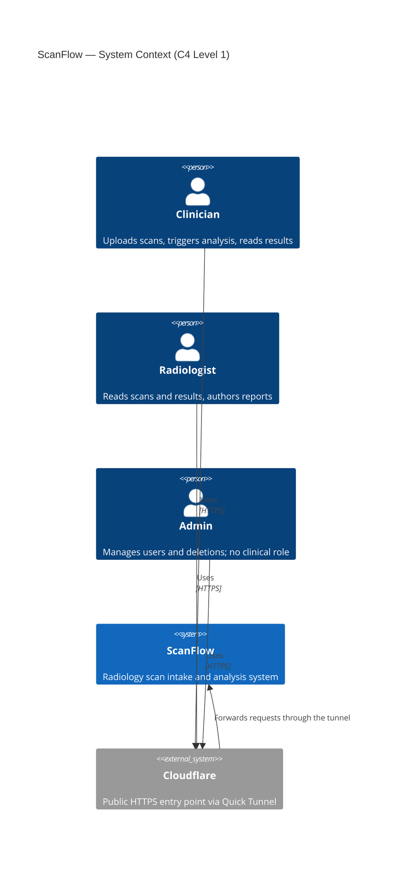
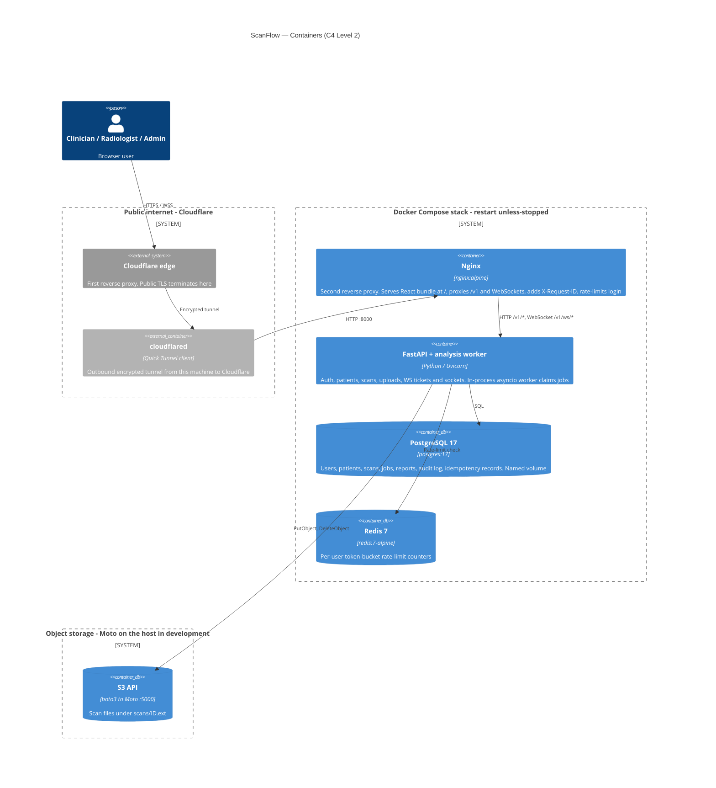
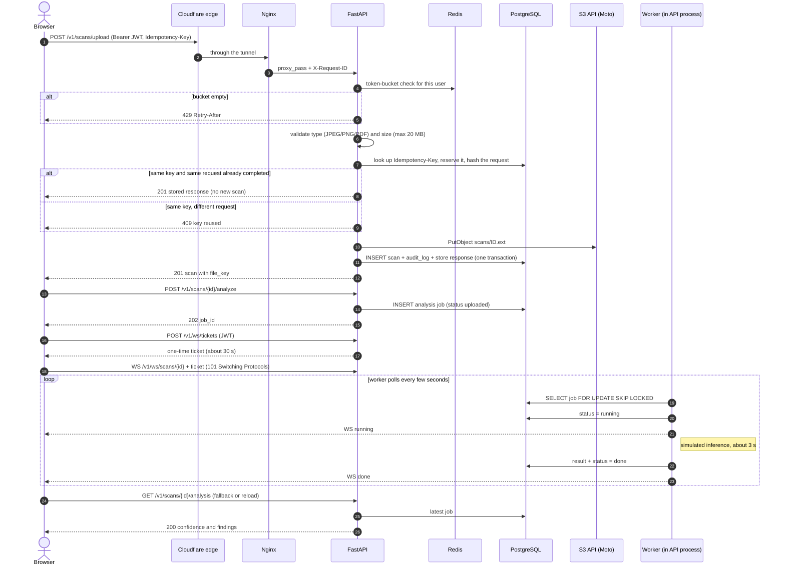
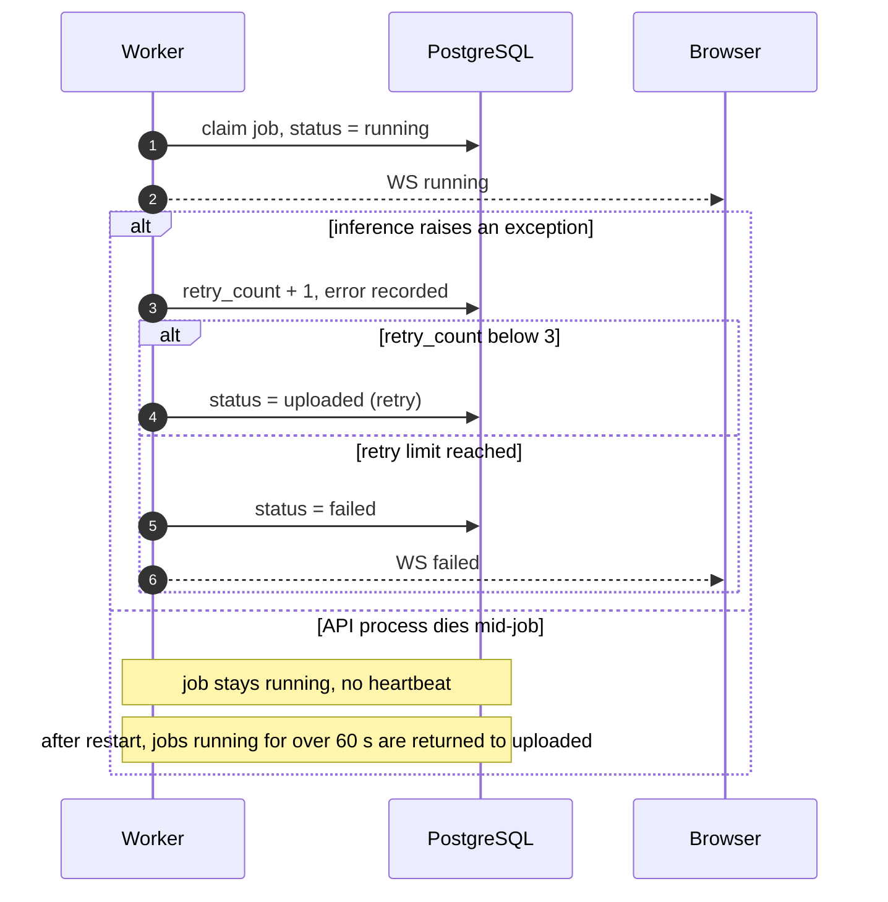
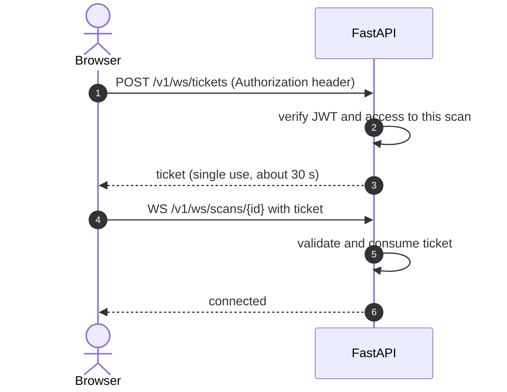

# ScanFlow — System Architecture

ScanFlow is a radiology scan intake and analysis API. Clinicians upload scans, trigger an analysis, and see the result arrive in the browser without refreshing.

**Current system in one line:** React bundle and API served behind Nginx → exposed through a Cloudflare Tunnel → FastAPI (with an in-process analysis worker) → PostgreSQL for records, Redis for rate limits, an S3-compatible API (Moto in development) for scan files.

This document describes the system **as it exists today**. The Day 16 design is kept in [§11](#11-how-the-design-changed-since-day-16) so the differences are visible rather than silently overwritten. Decisions and their trade-offs live in [`docs/adr/`](adr/README.md).

## Contents

1. [Who uses it](#1-who-uses-it)
2. [What is inside the request and what happens afterwards](#2-what-is-inside-the-request-and-what-happens-afterwards)
3. [Where data and files live](#3-where-data-and-files-live)
4. [Request path, TLS and the tunnel](#4-request-path-tls-and-the-tunnel)
5. [Diagram: system context (C4 level 1)](#5-diagram-system-context-c4-level-1)
6. [Diagram: containers (C4 level 2)](#6-diagram-containers-c4-level-2)
7. [Sequences](#7-sequences)
8. [Capacity estimate](#8-capacity-estimate)
9. [Failure modes](#9-failure-modes)
10. [Known limits](#10-known-limits)
11. [How the design changed since Day 16](#11-how-the-design-changed-since-day-16)

---

## 1. Who uses it

Every request comes from an authenticated user in exactly one role. There is no anonymous access except login/registration and the health check.

| Role | Can do |
|---|---|
| Clinician | Create patients, upload scans, trigger analysis, read results |
| Radiologist | Read patients, scans and results; author reports |
| Admin | Delete records and manage users; deliberately **not** a clinical role |

Authorization is enforced per endpoint (`require_role(...)`), not by separate systems per role.

## 2. What is inside the request and what happens afterwards

This split decides the API shape.

**Inside the request (synchronous).** Anything the caller needs confirmed before moving on: authentication, per-user rate limiting, validation (type and 20 MB size), the idempotency check, writing the file to object storage, and inserting the scan plus its audit row.

**After the request returns (asynchronous).** Running the analysis. It takes about 3–5 seconds, so `POST /v1/scans/{id}/analyze` returns `202 Accepted` with a job id and the work is done by the worker. The result reaches the browser over a WebSocket, with HTTP polling as a fallback ([ADR 0001](adr/0001-async-analysis-pipeline.md), [ADR 0004](adr/0004-websocket-status-with-one-time-tickets.md)).

## 3. Where data and files live

| Data | Home | Why |
|---|---|---|
| Users, patients, scans, analysis jobs and results, reports, audit log, idempotency records | PostgreSQL 17 (named volume `postgres-data`) | Queried, filtered and joined; needs transactions |
| Scan images / PDFs | S3-compatible object storage, key `scans/{scan-id}.{ext}` (Moto in development, real S3 later) | Large opaque blobs; must not bloat table and backup size ([ADR 0003](adr/0003-object-storage-for-files.md)) |
| Rate-limit counters | Redis 7 | Fast, shared, expendable state |

The database stores only `file_key`, never the file bytes and never a server filesystem path.

## 4. Request path, TLS and the tunnel

```text
Browser ──HTTPS──▶ Cloudflare edge ──tunnel──▶ cloudflared ──HTTP──▶ Nginx ──HTTP──▶ FastAPI
                   (TLS terminates here)                              │  (static bundle served here)
                                                                      └─ / → React build, /v1/* → API, /v1/ws/* → API (Upgrade)
```

**Where does TLS terminate?** At Cloudflare's edge. Cloudflare is the first reverse proxy; our Nginx is the second.

| Hop | Encrypted? | Acceptable? |
|---|---|---|
| Browser → Cloudflare | Yes (HTTPS / WSS) | Required |
| Cloudflare → `cloudflared` | Yes (tunnel) | Required |
| `cloudflared` → Nginx | No (plain HTTP on the host) | Yes for a local demo: it never leaves the machine |
| Nginx → FastAPI | No (plain HTTP on the Docker bridge network) | Yes for a demo; for real patient data, end-to-end TLS would be expected |
| FastAPI → PostgreSQL / Redis / S3 | No (Docker network, local) | Same reasoning; RDS would be configured to require TLS |

**Static bundle:** served by Nginx at `/`. Because the page and the API share one origin, the CORS middleware from Day 32 is no longer needed.

**WebSocket handshake:** the browser sends an HTTP request with `Upgrade: websocket` and `Connection: upgrade`; the server completes it with `101 Switching Protocols`. Nginx must forward both headers (`proxy_http_version 1.1`), or the upgrade silently fails.

**Quick Tunnel limits, and why they matter:** the URL dies with the process and changes on every start; it is capped at 200 in-flight requests; it has no SLA. That is fine for a demo because one person is watching. It disqualifies it for production because a stable address, availability guarantees and capacity headroom are the product.

## 5. Diagram: system context (C4 level 1)



## 6. Diagram: containers (C4 level 2)



The worker is not a separate container: it is an asyncio task inside the API process ([ADR 0005](adr/0005-in-process-analysis-worker.md)). It claims jobs from PostgreSQL and pushes status to browsers through the API's WebSocket manager.

## 7. Sequences

### 7.1 Upload, analyse, and live status



### 7.2 Failure, retry and a crashed worker



### 7.3 WebSocket authentication



The long-lived JWT never appears in a URL, so it never lands in Nginx access logs, Cloudflare logs or browser history ([ADR 0004](adr/0004-websocket-status-with-one-time-tickets.md)).

## 8. Capacity estimate

Every number below traces back to a stated assumption. Change an assumption and the arithmetic can be redone.

**Assumptions**

| # | Assumption |
|---|---|
| A1 | 5 requests per scan journey (upload, analyze, ticket, 2 status reads) |
| A2 | 30% of daily volume lands in the busiest hour; arrivals burst up to 3× within it |
| A3 | Average stored size 20.4 MB per scan (20 MB image + 0.8 × 0.5 MB report PDF) |
| A4 | 4 s of worker time per job, one serial worker |
| A5 | Rows per scan: 1 scan, 0.8 reports, 0.25 new patients, 4 audit rows |
| A6 | 365 operating days per year |

| | **200 scans/day** | **20,000 scans/day** |
|---|---|---|
| Requests/day (A1) | 200 × 5 = 1,000 | 20,000 × 5 = 100,000 |
| Busiest hour (A2) | 300 req → 0.083 req/s | 30,000 req → 8.3 req/s |
| Peak burst (×3) | ≈ 0.25 req/s | ≈ 25 req/s |
| Storage/day (A3) | 200 × 20.4 MB = 4.08 GB | 20,000 × 20.4 MB = 408 GB |
| Storage/year (A6) | ≈ 1.5 TB | ≈ 149 TB |
| `audit_log` rows/year (A5) | 800/day → 292,000 | 80,000/day → 29.2 million |
| Worker time needed/day (A4) | 200 × 4 s = 800 s ≈ 13 min | 20,000 × 4 s = 80,000 s ≈ 22.2 h |
| Jobs in busiest hour | 60 → 240 s of work (6.7% of the hour) | 6,000 → 24,000 s of work |
| One worker's ceiling | 3,600 ÷ 4 = 900 jobs/h → 15× headroom | 900 jobs/h → **6.7× short** |
| **First bottleneck** | None; over-provisioned everywhere | **The single worker**, then storage growth |

**Measured, not assumed.** The Day 39 load test ([`notes/load-testing.md`](../notes/load-testing.md)) drove the read endpoint with 100 concurrent users and sustained about 216 req/s with 0 failures (p95 680 ms), roughly eight times the 25 req/s peak estimated above. The API tier is therefore not the first thing to break at 20,000 scans/day; the worker is. The same test showed the API process near 100% CPU, which matters if inference ever runs in-process ([ADR 0005](adr/0005-in-process-analysis-worker.md)).

**Caveat on the 900/h figure.** It assumes back-to-back processing. The worker loop as reviewed claims one job per iteration and then sleeps 5 s, so with a 3 s simulated job the effective rate is closer to 3,600 ÷ (3 + 5) = 450 jobs/h. The shortfall at 20,000 scans/day is therefore larger than 6.7×, not smaller.

**What fixes it:** more worker processes. `SELECT ... FOR UPDATE SKIP LOCKED` already lets several claimers run safely; the work is extracting the worker and sharing WebSocket events between processes. At 148.9 TB/year only real object storage with lifecycle tiering is viable.

## 9. Failure modes

This table is the backbone of the [runbook](runbook.md).

| Component | What happens when it fails | What the user sees | Recovers on its own? | Needs a human when | Data that could be lost |
|---|---|---|---|---|---|
| **Nginx** | Proxy stops serving | Connection error / Cloudflare error page | Yes (`restart: unless-stopped`) | It crash-loops (check `nginx -t`) | None; stateless |
| **API** | Process dies or restarts; WebSockets drop | `502` from Nginx (refused), or `504` after 5 s if its network endpoint is gone; browser reconnects sockets | Yes (restart policy) | It loops on startup (bad migration, bad config) | In-flight request. The DB transaction rolls back; the uploaded object is deleted best-effort, but a hard kill between `PutObject` and commit leaves an orphaned object, and a reserved idempotency key may be left behind (see runbook) |
| **Worker** (in-process task) | If the API dies mid-job the job stays `running` (no heartbeat). If the task alone dies, the API stays healthy but analysis stops | Status never changes from `running`/`uploaded` | Partly: after an API restart, jobs `running` for over 60 s are returned to `uploaded`. A dead task is **not** restarted by anything | The task dies silently (`/healthz` checks the database only), so restart the API | Time, not data: the job is re-claimed. Result is written transactionally, so no half-written result |
| **PostgreSQL** | Database unreachable | `500` on any DB call; `/healthz` fails; API goes unhealthy | Yes, if the volume is intact | Volume or disk is damaged, then restore from `pg_dump` | Committed data is safe on the volume. Everything since the last backup if the volume is lost; `down -v` deletes it deliberately |
| **Redis** | Rate limiter cannot read counters. As written it has no fallback, so it fails closed | `500` on rate-limited routes (scan endpoints) until Redis returns | Yes (restart policy) | It will not stay up | Counters only; nothing of record. Whether to fail open or closed is an open decision |
| **Object storage** (Moto) | S3 endpoint unreachable | Uploads fail with `500`/`502`; the DB insert is rolled back so no half-created scan | Depends on the emulator; usually not | Usually yes | **Moto is in-memory: restarting it loses every stored file while database rows survive**, leaving dangling `file_key`s. Real S3 does not have this problem |
| **Cloudflare Tunnel** | `cloudflared` stops, or restarts with a new URL | Public URL dead immediately; `http://localhost:8000` still works | No (ephemeral by design) | Always: restart it and share the new URL | None; stateless |
| **Docker Desktop / laptop reboot** | All containers stop | Everything down | Containers return once Docker Desktop starts | Moto and `cloudflared` are **not** supervised by Compose and must be started by hand | None if the volume persists |

Nginx caches the address of `api` when it loads its config. If the API container is recreated (new IP) Nginx can keep proxying to a dead address and return `504`; `nginx -s reload` (or restarting Nginx) fixes it. See [`notes/nginx.md`](../notes/nginx.md) for the 502/503/504 experiments.

## 10. Known limits

- **One worker, in the API process.** Cannot scale independently; shares CPU and fate with the API ([ADR 0005](adr/0005-in-process-analysis-worker.md)).
- **WebSocket manager is process-local.** Running a second API process needs a shared broker (for example Redis Pub/Sub). Polling remains as the fallback.
- **Stale-job detection keys on `created_at`,** not a start time or lease. Fine for one worker; must change before several.
- **Moto is not durable.** Real S3 with an IAM role is the production path ([`aws-migration.md`](aws-migration.md)).
- **Quick Tunnel** is a demo vehicle only ([§4](#4-request-path-tls-and-the-tunnel)).

## 11. How the design changed since Day 16

The Day 16 design set the direction: REST under `/v1`, JWT with three roles, PostgreSQL for records, files kept out of the database, asynchronous analysis through a worker, containers behind a reverse proxy. Everything below is a divergence between that plan and what was built.

| # | Area | Day 16 / Day 27 design | What exists now |
|---|---|---|---|
| 1 | Persistence | In-memory first, PostgreSQL later | PostgreSQL 17 in Compose with a named volume and Alembic migrations |
| 2 | Auth | JWT + roles planned | Implemented; per-endpoint role checks |
| 3 | Edge | Nginx "later"; tunnel not designed | Cloudflare edge (TLS) → Nginx → API; Nginx serves the React bundle, so CORS was removed |
| 4 | Compose services | api, db | api, db, nginx, redis |
| 5 | File storage | Mounted volume, S3 later | S3 API through boto3 now (Moto in development); database holds `file_key` |
| 6 | Upload | `POST /v1/scans`, a file path | `POST /v1/scans/upload` (multipart: `patient_id`, `modality`, `body_part`, `acquired_at`, `file`) plus required `Idempotency-Key`; JPEG/PNG/PDF, 20 MB max |
| 7 | Analysis states | `pending` | `uploaded → running → done` or `failed`, retries up to 3, stale-job recovery |
| 8 | Status delivery | HTTP polling | WebSocket with one-time tickets; polling (2→4→8→15 s) kept as fallback; browser reconnects with backoff |
| 9 | Scan listing | Offset pagination | Cursor pagination (`limit` + `cursor`, ordered by id) plus full-text search `q` over report findings (GIN index) |
| 10 | Rate limiting | Per IP at Nginx | Nginx on `/v1/auth/token`, plus Redis per-user token bucket on scan routes |
| 11 | Observability | Not specified | `X-Request-ID` generated at Nginx and carried into API and worker logs; upstream timing in the Nginx log; slow-query logging enabled |
| 12 | Worker | Separate background worker | In-process asyncio task ([ADR 0005](adr/0005-in-process-analysis-worker.md)) |
